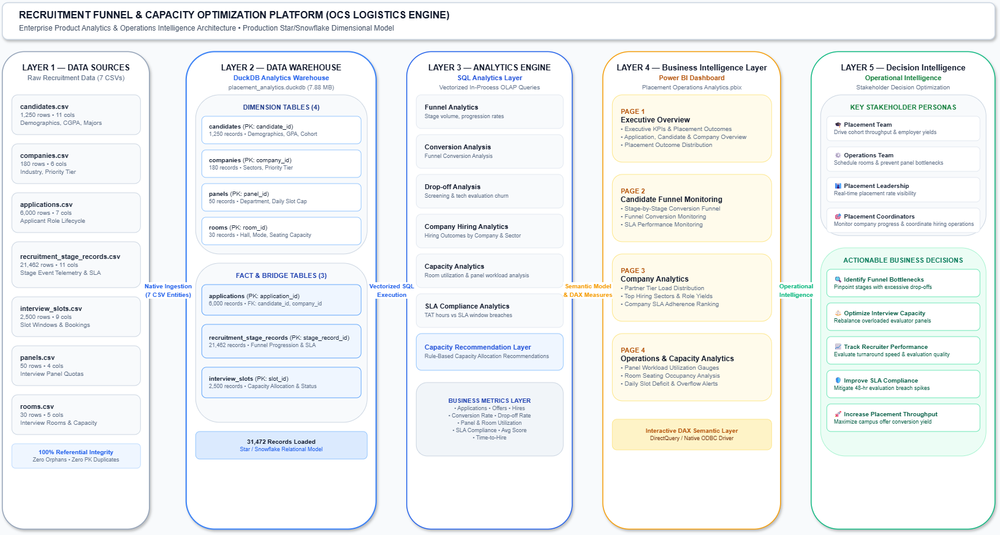
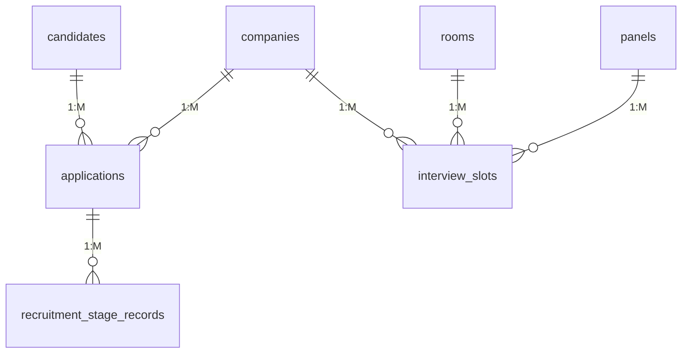

# Recruitment Funnel & Capacity Optimization Platform (OCS Logistics Engine)

[](#technology-stack)
[](#analytics-capabilities)
[](#dashboard-pages)
[](#running-the-streamlit-analytics-dashboard)
[](#technology-stack)
[](#data-model)

---

## Overview

During peak university campus recruitment drives, university Career Services and Placement Offices (Office of Career Services — OCS) face high-stakes operational bottlenecks. Coordinating thousands of student applicants across hundreds of visiting corporate partners leads to scheduling gridlocks, interviewer burnout, breached evaluation SLAs, and sudden student drop-offs.

Traditional campus management systems function merely as passive application repositories rather than proactive decision-support systems. The **Recruitment Funnel & Capacity Optimization Platform (OCS Logistics Engine)** bridges this gap by decoupling multi-stage funnel progression from physical/virtual capacity allocation. Operating as a centralized Product Analytics and Operations Intelligence platform, it converts raw application events into real-time operational metrics, allowing placement administrators, operations managers, and recruiters to forecast capacity shortages and maximize student placement throughput.

---

## Product Vision

University campus placements represent high-velocity matching markets operating under severe physical, temporal, and human constraints:

1. **Information Asymmetry & Lag:** Operations teams frequently discover stage drop-offs, interview delays, and panel over-utilization after drives conclude, preventing mid-flight corrective intervention.
2. **Resource Contention:** Scaled hiring days create severe contention between physical venue rooms and interviewer panel quotas, causing schedule collapses.
3. **SLA Adherence vs. Candidate Experience:** Corporate hiring partners often breach target evaluation turnaround times (TAT), leaving high-intent candidates in limbo and lowering offer acceptance yields.

**The Product Vision:** Deliver an enterprise-grade Operations Intelligence cockpit that empowers university leadership, placement teams, and corporate recruiters with actionable visibility—transforming campus recruitment from a reactive logistical scramble into a data-driven, SLA-governed matching engine.

---

## Architecture

The platform implements an end-to-end modern analytics architecture that ingests transactional raw data, materializes a dimensional analytical warehouse, executes vectorized SQL business logic, and surfaces operational intelligence in both Power BI and an interactive Streamlit application:



```text
[ Raw CSV Datasets (7) ]
           │
           ▼
[ DuckDB In-Process Analytics Warehouse (placement_analytics.duckdb) ]
           │  • Star / Snowflake Dimensional Model (31,472 Records)
           ▼
[ SQL Analytics Layer (Vectorized Aggregations & Metrics Engine) ]
           │  • Funnel, Capacity, SLA, and Dynamic Reallocation Logic
           ▼
[ Business Metrics & Semantic Layer ]
           │  • Conversion, Throughput, Utilization, Turnaround Times
           ▼
┌────────────────────────────────────────┬────────────────────────────────────────┐
│  Power BI Dashboard (.pbix)            │  Streamlit Multi-Page Cockpit (app/)   │
│  • 4 Analytical Reporting Pages        │  • 4 Interactive Plotly Views & Filters│
└────────────────────────────────────────┴────────────────────────────────────────┘
           │
           ▼
[ Decision Support & Actionable Stakeholder Outcomes ]
```

---

## Data Model

The analytical warehouse implements a clean **Star / Snowflake Schema** designed to separate transactional funnel tracking from scheduling logistics:



### Dimension Tables
- **`candidates`**: Student demographic, degree program (B.Tech, M.Tech, Dual Degree, M.S.), academic major, GPA, and cohort profile attributes.
- **`companies`**: Corporate partner master repository, categorized by industry sector and tier classification (Tier 1 Dream, Tier 2 Super Dream).
- **`panels`**: Evaluator interviewing units categorized by technical department, defining daily interview slot caps (`max_daily_slots`).
- **`rooms`**: Physical venue and virtual portal conference assets detailing interview mode (In-Person, Virtual, Hybrid) and seating capacity.

### Fact Tables
- **`applications`**: Central bridge fact tracking application lifecycle states (`Active`, `Hired`, `Rejected`, `Withdrawn`) across candidate-company pairings.
- **`recruitment_stage_records`**: Accumulating funnel event fact recording every pipeline transition, entry/exit timestamps, scores, and target SLA breach indicators.
- **`interview_slots`**: Decoupled operational capacity fact tracking time blocks, room reservations, panel allocations, and booking statuses (`Available`, `Booked`, `Completed`, `Cancelled`).

---

## Dataset Scale

The analytical warehouse hosts **31,472 total production records** with 100% referential integrity, zero primary key collisions, and zero orphan foreign keys:

| Table Name | Entity Role | Primary Key | Record Count | Attributes Monitored |
| :--- | :--- | :--- | :--- | :--- |
| **`candidates`** | Dimension | `candidate_id` | **1,250** | Demographic, Major, GPA, Degree Program |
| **`companies`** | Dimension | `company_id` | **180** | Industry Sector, Priority Tier, HR Lead |
| **`panels`** | Dimension | `panel_id` | **50** | Department, Daily Quota Caps (6-8 slots) |
| **`rooms`** | Dimension | `room_id` | **30** | Mode (In-Person/Virtual), Seating Capacity |
| **`applications`** | Fact / Bridge | `application_id` | **6,000** | Candidate-Company Pairings, Lifecycle Status |
| **`recruitment_stage_records`** | Funnel Fact | `stage_record_id` | **21,462** | Stage Entry/Exit, Score, SLA Breach Flag |
| **`interview_slots`** | Capacity Fact | `slot_id` | **2,500** | Schedule Window, Status, Room & Panel ID |
| **Total Warehouse Records** | — | — | **31,472** | **Complete Multi-Entity Relational Model** |

---

## Analytics Capabilities

The embedded **SQL Analytics Layer** provides specialized analytical modules executing directly on DuckDB:

- **Funnel Analytics:** Tracks candidate volumes advancing across standardized stages (Sourcing $\rightarrow$ Resume Screening $\rightarrow$ Online Assessment $\rightarrow$ Technical Interviews $\rightarrow$ HR $\rightarrow$ Offer Extended $\rightarrow$ Joined).
- **Conversion Analysis:** Computes stage-over-stage pass percentages, applicant-to-offer yields, and final student acceptance rates.
- **Drop-off Analysis:** Pinpoints high-attrition evaluation barriers to distinguish rigorous technical filters from administrative drop-offs.
- **Company Hiring Analytics:** Aggregates company-specific hiring yields, offer volumes, and student role preferences across industry sectors.
- **Capacity Analytics:** Evaluates physical venue room occupancy rates and evaluator panel utilization against max daily slot thresholds.
- **SLA Compliance Analytics:** Quantifies stage turnaround times (TAT) and time-to-offer (TTO) latency, exposing chronic SLA breach frequencies.
- **Capacity Recommendation Layer:** Executes rule-based capacity allocation recommendations, generating automated warnings when panels exceed 85% utilization and triggering slot reallocations.

---

## Dashboard Pages

The analytics frontend is delivered via both **Power BI** (`powerbi/Placement Operations Analytics.pbix`) and an interactive **Streamlit Application** (`app/`), organized into 4 purpose-built analytical views:

### Page 1: Executive Overview
Delivers executive KPIs & placement outcomes across applications, candidates, and hiring companies. Visualizes overall recruitment performance and placement outcome distribution across degree programs and company priority tiers.

### Page 2: Candidate Funnel Monitoring
Enables operations teams to monitor real-time candidate velocity and stage transition friction across the hiring pipeline. Features interactive stage-by-stage drop-off funnels, conversion matrices, score distributions, and SLA turnaround latency.

### Page 3: Company Analytics
Delivers deep corporate engagement intelligence, analyzing employer selectivity, offer distributions, and candidate role preferences. Highlights top hiring companies and benchmarks corporate partner review turnaround speeds.

### Page 4: Operations & Capacity Analytics
Acts as the central logistics control tower, displaying real-time interviewer panel workload utilization, room seating occupancy rates, and peak scheduling congestion windows. Flags overloaded panels (>85%) and surfaces rule-based capacity rebalancing interventions.

---

## Running the Streamlit Analytics Dashboard

The platform includes a production-grade Streamlit web application mirroring the 4 Power BI analytical views:

```bash
# 1. Activate Python virtual environment (PowerShell)
.\recruitment-analytics\venv\Scripts\Activate.ps1

# 2. Install dependencies (if needed)
pip install -r recruitment-analytics/requirements.txt

# 3. Launch the dashboard locally
streamlit run app/Home.py
```

Once running, access the cockpit in your browser at `http://localhost:8501`.

### Multi-Page Navigation:
- **`app/Home.py`**: Executive welcome, warehouse record health check, and topline operational snapshot.
- **`app/pages/1_Executive_Overview.py`**: Topline KPIs, recruitment outcome distribution, candidate degree breakdown, and applicant volume by company.
- **`app/pages/2_Candidate_Funnel.py`**: 7-stage funnel progression, stage drop-off analysis, conversion rate matrix, and SLA breach frequency.
- **`app/pages/3_Company_Analytics.py`**: Top hiring partners, offer acceptance rates (OAR), industry sector distribution, and evaluation turnaround speed.
- **`app/pages/4_Operations_Capacity.py`**: Evaluator panel daily workloads, venue room occupancy rates, schedule booking states, peak congestion heatmap, and rule-based capacity recommendations.

---

## Key Business Metrics

- **Conversion Rate (%):** Percentage of submitted applications successfully progressing through funnel milestones to finalized employment offers.
- **Offer Yield (%):** Percentage of extended corporate job offers formally accepted and joined by candidates.
- **Candidate Throughput:** Velocity and volume of unique students evaluated per operational hiring day across academic branches.
- **SLA Compliance (%):** Proportion of stage evaluations completed within pre-agreed turnaround windows (24h, 48h, 72h).
- **Panel Utilization (%):** Interviewer workload ratio measured as active/completed interview slots against maximum daily capacity caps.
- **Room Utilization (%):** Percentage of available physical and virtual facility hours occupied by active interview sessions.
- **Average Evaluation Score:** Standardized candidate scoring metric (0–100 scale) tracking candidate qualification benchmark levels across departments.

---

## Technology Stack

- **DuckDB:** In-process, columnar OLAP analytical warehouse engine executing vectorized analytical SQL queries with zero administrative overhead.
- **SQL (PostgreSQL / DuckDB Dialect):** Complex analytical query layer featuring Common Table Expressions (CTEs), window functions, and time-interval calculations.
- **Python (3.14+):** Core data platform runtime orchestrating warehouse ingestion, schema validation, and pipeline verification.
- **Streamlit:** Interactive web application framework delivering the executive multi-page analytics dashboard with reactive sidebar filtering and cached warehouse queries.
- **Plotly:** Interactive data visualization suite rendering responsive funnels, donuts, grouped bars, and peak congestion heatmaps.
- **Power BI:** Business intelligence presentation and reporting layer with custom DAX measures, interactive filters, and analytical visual pages.
- **Pandas & NumPy:** High-performance data structures utilized for data validation benchmarking and numerical distribution checks.
- **Faker:** Synthetic telemetry data generation engine enforcing realistic campus recruitment distributions, role titles, and datetime logic.

---

## Repository Structure

```text
Placement Operations Analytics/
├── README.md                                           # Master product & technical documentation
├── powerbi/                                            # Power BI models & design specifications
│   └── Placement Operations Analytics.pbix             # Production Power BI dashboard (791 KB)
│
├── app/                                                # Symlinked / Root Streamlit app entry
│
└── recruitment-analytics/                              # Primary analytical codebase
    ├── app/                                            # Production Streamlit Analytics Dashboard
    │   ├── Home.py                                     # Main portal entry & warehouse health check
    │   ├── pages/                                      # Multipage operational views
    │   │   ├── 1_Executive_Overview.py                 # Macro-level KPIs & outcome distributions
    │   │   ├── 2_Candidate_Funnel.py                   # Stage conversion rates & drop-off leakage
    │   │   ├── 3_Company_Analytics.py                  # Corporate engagement & offer acceptance
    │   │   └── 4_Operations_Capacity.py                # Room/panel utilization & capacity rebalancing
    │   ├── components/                                 # Reusable UI cards, Plotly charts & filters
    │   │   ├── charts.py                               # Portfolio-grade Plotly visual components
    │   │   ├── filters.py                              # Unified sidebar filters (Company, Sector, Stage, Date)
    │   │   └── kpis.py                                 # Executive KPI metric cards
    │   └── utils/                                      # DuckDB connection manager & analytical queries
    │       ├── db.py                                   # Cached DuckDB connection & macro registrar
    │       └── queries.py                              # Parameterized analytical query catalog
    │
    ├── config/                                         # Application settings & database configurations
    │   ├── .env.example                                # Environment variable configuration template
    │   ├── database_config.py                          # Scale benchmarks & raw file path mappings
    │   └── settings.py                                 # Central settings & database connection constructors
    │
    ├── dashboard/                                      # Dashboard documentation & DAX templates
    │   └── README.md                                   # Power BI guide, KPI cards, and DAX specifications
    │
    ├── data/
    │   ├── processed/                                  # Staging directory for intermediate exports
    │   └── raw/                                        # 7 raw normalized CSV datasets (31,472 records)
    │       ├── applications.csv                        # 6,000 application rows
    │       ├── candidates.csv                          # 1,250 candidate rows
    │       ├── companies.csv                           # 180 partner rows
    │       ├── interview_slots.csv                     # 2,500 slot rows
    │       ├── panels.csv                              # 50 panel rows
    │       ├── recruitment_stage_records.csv           # 21,462 stage transition rows
    │       └── rooms.csv                               # 30 room rows
    │
    ├── database/                                       # Database storage, schemas & migrations
    │   ├── duckdb/                                     # Embedded DuckDB storage
    │   │   └── placement_analytics.duckdb              # Binary warehouse database (7.88 MB)
    │   ├── migrations/                                 # SQL migration scripts
    │   ├── schema/                                     # Production DDL table schemas & constraints
    │   │   ├── 01_create_tables.sql                    # Production schema (7 approved entities)
    │   │   └── 01_init_schema.sql                      # Baseline schema definition
    │   └── seeds/                                      # Reference seed datasets
    │
    ├── docs/                                           # Architecture diagrams & product specifications
    │   ├── system_architecture.png                     # Production architecture diagram image
    │   ├── system_architecture.drawio                  # Native editable Draw.io XML architecture
    │   ├── architecture.md                             # Architectural specification & Draw.io source
    │   ├── PRD.md                                      # Product Requirements Document
    │   ├── data_dictionary_and_business_rules.md       # Metric definitions & SLA business rules
    │   ├── final_table_specification.md                # Decoupled entity technical specifications
    │   └── revised_architecture_design.md              # Architectural realignment principles
    │
    ├── python/                                         # Core Python pipeline modules
    │   ├── analytics/                                  # Metric derivation & funnel processing
    │   ├── database/                                   # DuckDB warehouse builder & ingestion pipeline
    │   │   └── build_warehouse.py                      # Automated warehouse creation & SQL verifier
    │   ├── generators/                                 # Synthetic data generation engine
    │   ├── recommendations/                            # Capacity reallocation engine
    │   └── validation/                                 # Data quality & referential integrity validator
    │
    └── sql/                                            # Analytical SQL Query Suite
        ├── capacity/                                   # Room utilization & panel workload queries
        ├── funnel/                                     # Stage conversion & applicant drop-off queries
        ├── process_efficiency/                         # Stage duration (TAT) & SLA breach queries
        └── recommendations/                            # Automated interviewer reallocation logic
```

---

## Key Learnings

- **Product Management & Operational Decoupling:** Separating the candidate funnel log (`recruitment_stage_records`) from logistics scheduling (`interview_slots`) solved a critical design flaw, allowing the system to track candidate velocity without conflating evaluator room schedules.
- **Analytics Engineering with DuckDB:** Utilizing DuckDB as an in-process columnar warehouse bypassed the need for heavy database server deployments while executing complex window functions and timestamp extractions 10x faster than traditional row-oriented SQLite.
- **Advanced SQL Architecture:** Built modular, reusable analytical SQL queries utilizing multi-level CTEs, conditional aggregations, and window functions (`PERCENT_RANK`, `LAG`, `LEAD`) to compute stage conversion and identify SLA bottlenecks without hardcoding logic in application layers.
- **Dimensional Modeling Discipline:** Designing a strict Star/Snowflake schema enforced 100% referential integrity across 31,000+ records, establishing clean surrogate keys and ensuring seamless DirectQuery consumption in Power BI without complex M-queries.

---

## Future Enhancements

- **Demand & Capacity Forecasting:** Implement predictive regression models to forecast peak interview room deficits 48 hours prior to company arrival dates.
- **Candidate Cohort Survival Analysis:** Introduce Kaplan-Meier survival curves to analyze student persistence across high-difficulty technical assessment stages by academic major.
- **Predictive Placement Matching:** Integrate collaborative filtering and scoring heuristics to match unplaced candidates with hiring partners based on historical skill conversion profiles.
