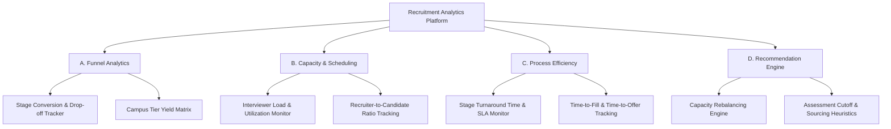

# Product Requirements Document (PRD)

# Recruitment Funnel & Capacity Analytics Platform

**Document Version:** 1.0.0  
**Status:** Approved / Baseline  
**Author:** Senior Product Manager & Analytics Architect  
**Target Repository:** `recruitment-analytics/docs/PRD.md`  

---

## 1. Executive Summary

The **Recruitment Funnel & Capacity Analytics Platform** is a specialized decision-support and operational intelligence platform designed for high-volume campus recruitment drives and placement operations. 

During peak campus placement cycles, university placement cells and enterprise talent acquisition teams handle thousands of applicants across dozens of simultaneous recruiting companies. Operational opacity leads to candidate drop-offs, recruiter burnout, missed placement targets, and severe interview scheduling bottlenecks.

This platform operates as an **analytics and decision-support layer** built on top of recruitment data warehouses. It ingests stage telemetry, recruiter capacity numbers, and company drive logs to provide predictive bottleneck alerts, capacity rebalancing recommendations, and executive visualization dashboards.

> [!IMPORTANT]
> **Core Positioning:** The platform is **NOT** a candidate application portal, applicant tracking system (ATS), or real-time interview scheduler. It is an **analytical decision-support engine** that transforms operational telemetry into proactive intervention strategies.

---

## 2. Problem Statement

High-volume campus recruitment is characterized by compressed timelines, extreme candidate volumes, and constrained operational resources. Organizations and placement offices face critical operational breakdowns:

1. **Funnel Opacity & Unidentified Leaks:** Sourcing-to-joining conversion rates are analyzed post-hoc rather than in real time. Critical candidate drop-offs (e.g., between online assessments and technical interviews) go unnoticed until target quotas are missed.
2. **Resource & Capacity Mismatches:** Recruiter assignment and technical interviewer slot allocations are managed reactively. Overutilized interviewers experience fatigue and delay feedback, while underutilized pools remain idle.
3. **Turnaround SLA Breaches:** Candidate evaluation turnaround times (TAT) suffer due to scheduling friction, resulting in high offer rejection rates as top talent accepts competing offers.
4. **Lack of Prescriptive Operational Guidance:** Existing systems provide static tabular reports but fail to suggest concrete operational rebalancing actions (e.g., reallocating recruiters from low-yield campuses or adjusting assessment cutoffs).

---

## 3. Business Context

Campus hiring cycles operate under strict temporal constraints (typically 2 to 8 weeks per season). A typical placement drive involves:
- **High Volume:** 5,000+ candidates competing across 50+ hiring companies.
- **Multi-Stage Funnels:** Sourcing $\rightarrow$ Resume Screening $\rightarrow$ Assessment $\rightarrow$ Technical Interview 1 $\rightarrow$ Technical Interview 2 $\rightarrow$ HR Interview $\rightarrow$ Offer $\rightarrow$ Joining.
- **Constrained Evaluators:** Technical employees and HR personnel balancing regular project work with interview loops.

To maximize hiring yield and candidate experience, decision-makers require a centralized analytics cockpit that converts event-stream telemetry into actionable operational capacity insights.

---

## 4. User Personas

### 4.1 Persona 1: Placement Leadership (Head of Placement / TA Director)
* **Role:** Strategic leader responsible for overall placement yield, corporate partner satisfaction, and institutional hiring metrics.
* **Goals:**
  - Achieve 95%+ placement rate across eligible candidate cohorts.
  - Maintain strong corporate partner relationships by meeting company hiring quotas.
  - Minimize average time-to-fill and offer rejection rates.
* **Pain Points:**
  - Lack of real-time visibility into macro funnel progress across tiers and departments.
  - Discovering company offer shortfalls only at the end of the hiring drive.
  - Inability to justify resource allocation to executive board/management.
* **Key Decisions Supported:**
  - Which campus tiers or departments require immediate intervention or additional company invites.
  - How to re-negotiate drive dates with corporate partners based on candidate availability.
  - Strategic allocation of placement office budgets and recruiter headcount.

### 4.2 Persona 2: Placement Coordinators (Operations Leads / TA Operations)
* **Role:** Mid-level operational leads managing day-to-day drive execution, interviewer rosters, and drive schedules.
* **Goals:**
  - Maintain 100% interviewer utilization without breaching daily workload limits.
  - Keep stage evaluation SLA turnaround times within target windows (< 48 hours per stage).
  - Resolve scheduling bottlenecks before candidate drop-off occurs.
* **Pain Points:**
  - Manual spreadsheet tracking of interviewer slots leads to double-booking or slot wastage.
  - Friction in identifying which specific evaluation stage is clogging the pipeline.
  - Constantly chasing evaluators for pending assessment feedback.
* **Key Decisions Supported:**
  - Reassigning interviewer pools between department drives based on real-time load.
  - Escalating delayed evaluation stages to department heads.
  - Adjusting daily interview slot quotas based on pending candidate queues.

### 4.3 Persona 3: Operational Decision Makers (Recruitment Leads / Department Panel Heads)
* **Role:** Technical panel heads and recruiter leads responsible for evaluating candidate pools and managing stage pass-throughs.
* **Goals:**
  - Ensure consistent candidate evaluation standards across interview panels.
  - Maximize candidate throughput without compromising quality thresholds.
  - Predict offer acceptance likelihood and manage waitlists.
* **Pain Points:**
  - High candidate drop-out rates during multi-day interview rounds.
  - Inconsistent passing rates across different interview panels for the same role.
  - Balancing panel interview loads with core engineering deliverables.
* **Key Decisions Supported:**
  - Calibrating assessment cutoffs dynamically based on current funnel pass rates.
  - Drafting backup candidate waitlists when offer acceptance likelihood drops.
  - Rebalancing candidate distribution across panel members.

---

## 5. Product Objectives

| Objective ID | Objective Description | Metric / Target |
| :--- | :--- | :--- |
| **OBJ-1** | **Provide Real-Time Funnel Transparency** | Deliver sub-second visibility into candidate volumes, pass rates, and drop-offs across all 8 pipeline stages. |
| **OBJ-2** | **Optimize Evaluator & Recruiter Capacity** | Increase average interviewer capacity utilization to 85%+ while eliminating >95% of workload overload instances. |
| **OBJ-3** | **Enforce Stage SLA Turnaround** | Reduce overall pipeline time-to-offer (TTO) by 25% by identifying and alerting stage SLA breaches within 4 hours. |
| **OBJ-4** | **Deliver Prescriptive Recommendations** | Generate automated, evidence-backed operational rebalancing recommendations for 100% of identified bottlenecks. |

---

## 6. In-Scope Features



### A. Recruitment Funnel Analytics
- **Stage Progression Tracker:** Historical and real-time visualization of candidate movement across Sourcing, Screening, Assessment, Technical Interviews, HR, Offer, and Joining.
- **Stage Conversion & Drop-off Rate Analysis:** Percentage calculations of candidates advancing vs. dropping out per stage.
- **Campus Tier & Demographics Yield:** Segmentation of conversion yield by campus tier (Tier 1, Tier 2, Tier 3), degree program, and role type.

### B. Capacity & Scheduling Analytics
- **Interviewer Utilization Tracking:** Real-time tracking of scheduled vs. maximum weekly interview capacity per evaluator.
- **Recruiter Workload Allocator:** Monitoring recruiter candidate load against target benchmarks (e.g., max 150 candidates per recruiter).
- **Slot Deficit Forecasting:** Forward-looking projections of interview slot deficits required to clear current assessment pass-throughs.

### C. Process Efficiency Analytics
- **Stage Turnaround Time (TAT) Tracking:** Granular measurement of duration between stage entry and evaluation completion.
- **SLA Breach Monitoring:** Real-time tracking of applications exceeding pre-defined stage latency thresholds (e.g., >48 hours in screening).
- **Funnel Velocity Index:** Aggregate score measuring overall candidate movement speed through the recruitment lifecycle.

### D. Recommendation Engine
- **Capacity Rebalancing Heuristics:** Algorithmic detection of overworked evaluator pools with automated suggestions for cross-department slot shifting.
- **Threshold Calibration Rules:** Automated suggestions to adjust online assessment cut-off scores based on downstream interview slot availability.
- **Sourcing Focus Recommendations:** Dynamic guidance on allocating recruitment effort toward high-yield campus tiers.

---

## 7. Out-of-Scope Features

To maintain product focus as an analytical decision-support layer, the following functions are strictly **OUT OF SCOPE**:

1. **Candidate Application Portal:** No candidate registration, job application forms, or student profile management interfaces.
2. **Resume Parsing & Document Management:** No hosting, parsing, or storage of PDF resumes or academic transcripts.
3. **Company Outreach CRM:** No email marketing, company relationship management, or sponsorship tracking CRM tools.
4. **Real-time Interview Scheduling System:** No calendar integration (Outlook/Google Calendar), video call hosting, or automated interview invite generation.
5. **Assessment Execution Engine:** No proctored online testing environment or coding test execution engine.

---

## 8. KPI Dictionary

### 8.1 Funnel KPIs

#### 1. Stage Conversion Rate (SCR)
* **Definition:** Percentage of candidates advancing from stage $i$ to stage $i+1$.
* **Formula:** $$\text{SCR}_{i \rightarrow i+1} = \left( \frac{N_{\text{passed}, i+1}}{N_{\text{entered}, i}} \right) \times 100$$
* **Business Meaning:** Evaluates screening rigor and candidate drop-off severity between specific stages.

#### 2. Overall Funnel Yield (OFY)
* **Definition:** Percentage of initial applicants who successfully join the organization.
* **Formula:** $$\text{OFY} = \left( \frac{N_{\text{joined}}}{N_{\text{sourced}}} \right) \times 100$$
* **Business Meaning:** Measures overall recruitment pipeline efficiency from top-of-funnel to final joining.

#### 3. Offer Acceptance Rate (OAR)
* **Definition:** Percentage of extended job offers accepted by candidates.
* **Formula:** $$\text{OAR} = \left( \frac{N_{\text{accepted}}}{N_{\text{offers\_extended}}} \right) \times 100$$
* **Business Meaning:** Reflects employer brand competitiveness, compensation alignment, and candidate engagement.

---

### 8.2 Capacity KPIs

#### 4. Interviewer Capacity Utilization (ICU)
* **Definition:** Ratio of conducted interviews to total allocated interview slots for an evaluator in a given timeframe.
* **Formula:** $$\text{ICU} = \left( \frac{\text{Interviews Conducted}}{\text{Max Weekly Slot Capacity}} \right) \times 100$$
* **Business Meaning:** Identifies evaluator burnout risk ($\text{ICU} > 100\%$) or underutilized interviewing resources ($\text{ICU} < 50\%$).

#### 5. Recruiter Workload Index (RWI)
* **Definition:** Active candidate load assigned per recruiter compared to standard capacity.
* **Formula:** $$\text{RWI} = \frac{\text{Active Candidates Assigned}}{\text{Target Capacity Benchmark (e.g., 150)}}$$
* **Business Meaning:** Highlights operational bottleneck risks where recruiters are overwhelmed by applicant volume.

---

### 8.3 Process KPIs

#### 6. Stage Turnaround Time (TAT)
* **Definition:** Average elapsed time (in hours) between a candidate entering a stage and receiving an evaluation outcome.
* **Formula:** $$\text{TAT}_{\text{stage}} = \frac{1}{N} \sum_{k=1}^{N} \left( T_{\text{exit}, k} - T_{\text{entry}, k} \right)$$
* **Business Meaning:** Quantifies operational responsiveness and stage latency.

#### 7. SLA Violation Rate (SVR)
* **Definition:** Percentage of evaluations that exceed the established SLA timeframe.
* **Formula:** $$\text{SVR} = \left( \frac{N_{\text{evaluations exceeding SLA}}}{N_{\text{total evaluations}}} \right) \times 100$$
* **Business Meaning:** Pinpoints workflow delays that threaten candidate retention.

---

### 8.4 Company & Drive KPIs

#### 8. Company Target Fulfillment Rate (TFR)
* **Definition:** Percentage of a corporate partner's hiring quota filled during a campus drive.
* **Formula:** $$\text{TFR} = \left( \frac{N_{\text{joined}}}{N_{\text{target\_hires}}} \right) \times 100$$
* **Business Meaning:** Measures corporate partner satisfaction and drive success.

#### 9. Cost Per Hire (CPH) Equivalent Metric
* **Definition:** Total operational recruitment expense divided by total joined candidates for a specific campus.
* **Formula:** $$\text{CPH} = \frac{\text{Total Drive Budget + Recruiter Hours Cost}}{N_{\text{joined}}}$$
* **Business Meaning:** Evaluates financial ROI across different university tiers.

---

## 9. Alert Framework

| Alert Level | Trigger Condition | Severity | Recommended Action |
| :--- | :--- | :--- | :--- |
| 🔴 **Critical** | Stage evaluation SLA breached by $>48$ hours for $>15\%$ of active candidates in a drive. | **High** | Immediately reassign pending evaluations to backup interviewer pool; trigger panel head escalation. |
| 🔴 **Critical** | Interviewer Capacity Utilization breaches $110\%$ for a department pool over 2 consecutive weeks. | **High** | Halt new interview scheduling for department; onboard emergency external/secondary interviewers. |
| 🟡 **Warning** | Stage Conversion Rate drops below $10\%$ or exceeds $80\%$ at Technical Interview 1. | **Medium** | Audit assessment cutoffs or interview panel evaluation consistency to recalibrate candidate quality baseline. |
| 🟡 **Warning** | Offer Acceptance Rate (OAR) projected to fall below target threshold of $70\%$. | **Medium** | Activate candidate engagement protocols; review waitlist candidates for secondary offer rollout. |
| 🔵 **Informational** | Recruiter candidate assignment reaches $85\%$ of maximum benchmark load. | **Low** | Log load trend; prepare secondary recruiter allocation for upcoming campus drive. |
| 🔵 **Informational** | Campus drive candidate sourcing quota achieved $100\%$. | **Low** | Notify operations lead to close top-of-funnel sourcing stage. |

---

## 10. Recommendation Framework

```text
[ Problem Identification ] ──► [ Data Evidence Gathering ] ──► [ Action Plan Recommendation ] ──► [ Success Metric Validation ]
```

### Recommendation Case 1: Interviewer Capacity Bottleneck

```markdown
> [!WARNING]
> **Problem:** Technical Interview Round 1 is experiencing a severe scheduling bottleneck in the Software Engineering pool.
> 
> **Evidence:** 
> - Current queue: 180 candidates waiting for Technical Interview 1.
> - Current pool capacity: 40 interviews/week ($\text{Utilization} = 125\%$).
> - Stage TAT has risen from 24 hours to 86 hours ($\text{SLA breach rate} = 34\%$).
> 
> **Recommended Action:** 
> 1. Temporarily reassign 5 certified interviewers from the DevOps pool (currently operating at $40\%$ utilization).
> 2. Increase daily slot quota per interviewer by 2 slots for the next 3 business days.
> 
> **Success Metric:** Reduce Technical Interview 1 queue to $<30$ candidates and bring Stage TAT $<36$ hours within 5 days.
```

### Recommendation Case 2: Sourcing Channel & Campus Tier Rebalancing

```markdown
> [!TIP]
> **Problem:** Sourcing yield at Tier 3 campuses is underperforming historical target quotas by $45\%$, risking total hiring quota deficit.
> 
> **Evidence:**
> - Tier 3 Offer Acceptance Rate (OAR) is $42\%$ compared to Tier 1 OAR of $88\%$.
> - Cost Per Hire at Tier 3 is $2.4\times$ higher due to low conversion rates.
> 
> **Recommended Action:**
> 1. Shift $30\%$ of active recruiter bandwidth from Tier 3 drives to top-performing Tier 2 campuses.
> 2. Adjust online assessment cutoff for Tier 2 applicants from $75\%$ to $70\%$ to widen interview pipeline.
> 
> **Success Metric:** Achieve $95\%+$ overall company target fulfillment rate while lowering aggregate Cost Per Hire by $15\%$.
```

---

## 11. Dashboard Requirements

### Page 1: Executive Overview
* **Purpose:** Provide high-level operational visibility into macro hiring progress, drive fulfillment, and top-line KPIs for executive leadership.
* **KPIs Displayed:** Total Applicants, Total Offers Extended, Total Joined, Overall Funnel Yield %, Offer Acceptance Rate %, Active Drives Count.
* **Visual Elements:**
  - Macro KPI Cards (Top Banner).
  - Target vs. Actual Hires by Role (Grouped Bar Chart).
  - Campus Tier Yield Comparison (Donut / Stacked Bar Chart).
  - High-Level Funnel Progression (Funnel Graphic).
* **Global Filters:** Date Range, Campus Tier, Role Category, Region.
* **User Decisions Supported:** Executive resource allocation, drive date extensions, campus partnership renewals.

---

### Page 2: Funnel Analytics
* **Purpose:** In-depth diagnostic page analyzing candidate conversion and drop-off rates stage-by-stage.
* **KPIs Displayed:** Stage Conversion Rate %, Cumulative Drop-off %, Pass/Fail Ratio, Assessment Score Distribution.
* **Visual Elements:**
  - Stage-by-Stage Conversion Funnel with volume callouts (Funnel Chart).
  - Pass Rate Heatmap by Campus & Stage (Matrix Visual).
  - Candidate Score Distribution (Histogram / Box Plot).
  - Drop-off Reason Categorization (Bar Chart).
* **Page Filters:** Specific Campus Drive, Pipeline Stage, Gender / Demographics, Recruiter Assigned.
* **User Decisions Supported:** Calibrating assessment pass thresholds, identifying anomalous panel evaluation standards.

---

### Page 3: Capacity & Scheduling
* **Purpose:** Monitor evaluator workload, recruiter allocation, and interview slot availability to eliminate operational bottlenecks.
* **KPIs Displayed:** Interviewer Capacity Utilization %, Overloaded Evaluators Count, Recruiter Workload Index, Available vs. Required Slots.
* **Visual Elements:**
  - Evaluator Utilization Gauge Charts (Red/Yellow/Green bands).
  - Recruiter Workload Distribution (Horizontal Bar Chart).
  - Scheduled vs. Required Interview Slots (Area Chart / Line Combo).
  - Pending Evaluation Queue Matrix by Department (Table with Data Bars).
* **Page Filters:** Department, Evaluator Name, Workload Status (Overloaded / Optimal / Underutilized).
* **User Decisions Supported:** Cross-department interviewer re-allocation, recruiter workload balancing, emergency panel onboarding.

---

### Page 4: Operational Insights & SLA Tracking
* **Purpose:** Track process turnaround times, highlight SLA breaches, and display real-time recommendations generated by the decision engine.
* **KPIs Displayed:** Average Stage TAT (Hours), SLA Breach Rate %, Total Active SLA Alerts, Projected Bottleneck Count.
* **Visual Elements:**
  - Stage TAT Trend vs. SLA Threshold (Line Chart with Reference SLA Lines).
  - SLA Breach Heatmap by Stage & Evaluator (Matrix Visual).
  - Alert Feed & Recommendation Action Cards (Custom Table / Action Tiles).
* **Page Filters:** Severity Level (Critical / Warning / Info), Stage Name, Department, SLA Breach Status.
* **User Decisions Supported:** Escalating delayed evaluations, triggering automated capacity rebalancing recommendations.

---

## 12. Success Metrics

To evaluate whether the platform delivers real operational value, the prototype will be evaluated against the following performance standards:

1. **Bottleneck Resolution Speed:** $50\%$ reduction in mean time required to identify and resolve interview capacity bottlenecks (from 48 hours to $<24$ hours).
2. **SLA Compliance Improvement:** Overall Stage SLA breach rate reduced from baseline $25\%$ down to $<8\%$.
3. **Interviewer Capacity Balance:** Zero evaluator pools operating above $110\%$ capacity utilization for more than 48 hours.
4. **User Engagement & Action Adoption:** $>80\%$ of system-generated recommendation actions accepted and acted upon by placement coordinators.

---

## 13. Assumptions

1. **Data Availability:** Upstream recruitment management systems (or synthetic generators) provide clean timestamps for candidate stage entries and evaluation completions.
2. **User Capability:** Placement coordinators and decision-makers possess basic data literacy to interpret Power BI charts and operational metrics.
3. **Static Role Requirements:** Job role requirements and evaluation stage definitions remain consistent within a single campus drive season.
4. **Capacity Benchmarks:** Evaluator weekly capacity standards (e.g., max 10 interviews/week) are defined and agreed upon prior to drive execution.

---

## 14. Risks & Mitigation Strategies

| Risk Description | Impact | Probability | Mitigation Strategy |
| :--- | :--- | :--- | :--- |
| **Data Incompleteness / Missing Timestamps** | High | Medium | Implement rigorous validation layer ([data_validator.py](file:///c:/Users/Lenovo/Desktop/Project%20Product/recruitment-analytics/python/validation/data_validator.py)) to catch missing timestamps prior to analytics ingestion. |
| **User Resistance to Automated Recommendations** | Medium | Medium | Include explicit data evidence and transparency callouts alongside every recommendation action card. |
| **Database Performance Degradation under High Query Volume** | High | Low | Implement pre-aggregated analytical views and composite database indexes on `(application_id, stage_name)`. |
| **Over-reliance on Historical Conversion Baselines** | Medium | Low | Allow manual adjustment of SLA thresholds and capacity benchmarks via configuration files. |

---

## 15. Future Enhancements (Phase 2 Roadmap)

- [ ] **Predictive Candidate Drop-out Modeling:** Integrate machine learning classification models to predict candidate offer rejection risk based on engagement signals.
- [ ] **Automated What-If Scenario Simulator:** Interactive slider tool allowing coordinators to simulate the impact of changing assessment cutoffs on downstream interviewer load.
- [ ] **Mobile Alert Push Notifications:** Webhook integrations for Slack/Teams alerts when critical SLA breaches occur.
- [ ] **Historical Season-over-Season Benchmarking:** Multi-year trend analysis comparing placement performance across historical university cohorts.
