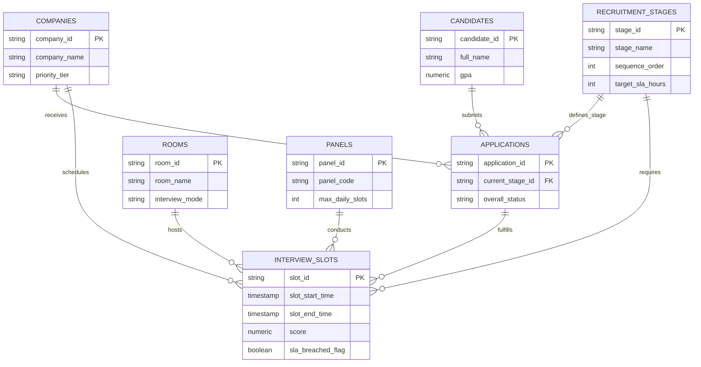

# Conceptual Data Model Architecture

# Recruitment Funnel & Capacity Analytics Platform

**Document Version:** 2.0.0 (Updated Baseline)  
**Author:** Senior Data Architect  
**Target Repository:** `recruitment-analytics/docs/conceptual_data_model.md`  

---

## 1. Executive Summary & Approved Scope

The **Recruitment Funnel & Capacity Analytics Platform** is strictly scoped as an **analytics and decision-support layer**.

Per the approved architecture correction, the platform relies **EXCLUSIVELY** on the 7 final approved entities:

1. **`candidates`**
2. **`companies`**
3. **`applications`**
4. **`recruitment_stages`**
5. **`interview_slots`**
6. **`rooms`**
7. **`panels`**

> [!IMPORTANT]
> The entities `placement_drives`, `recruiters`, `interviewers`, and `stage_evaluations` have been removed from the architecture scope. Do not reintroduce them.

---

## 2. Approved Scale Assumptions

| Entity Target | Minimum Target | Maximum Target | Target Benchmark |
| :--- | :---: | :---: | :---: |
| **Candidates** | 1,000 | 1,500 | 1,250 |
| **Companies** | 150 | 300 | 200 |
| **Applications** | 4,000 | 8,000 | 6,000 |
| **Recruitment Stage Records (Slots)** | 20,000 | 60,000 | 40,000 |

---

## 3. Entity Conceptual Specifications

### 1. `candidates`
* **Business Purpose:** Master repository of student applicants.
* **Primary Key:** `candidate_id`
* **Core Attributes:** `full_name`, `email`, `phone_number`, `degree_program`, `academic_major`, `gpa`, `cgpa_band`, `graduation_year`, `gender`.

### 2. `companies`
* **Business Purpose:** Hiring partner organizations conducting recruitment drives.
* **Primary Key:** `company_id`
* **Core Attributes:** `company_name`, `industry_sector`, `priority_tier`, `contact_email`.

### 3. `applications`
* **Business Purpose:** Central candidate job application anchor linking students to companies.
* **Primary Key:** `application_id`
* **Core Attributes:** `candidate_id` (FK), `company_id` (FK), `current_stage_id` (FK), `applied_role`, `overall_status`, `application_date`.

### 4. `recruitment_stages`
* **Business Purpose:** Master pipeline stage dictionary defining stage sequence and SLA limits.
* **Primary Key:** `stage_id`
* **Core Attributes:** `stage_name`, `sequence_order`, `target_sla_hours`, `is_interview_stage`.

### 5. `rooms`
* **Business Purpose:** Physical desks or virtual conference link resources allocated for interviews.
* **Primary Key:** `room_id`
* **Core Attributes:** `room_name`, `building_location`, `interview_mode`, `seating_capacity`.

### 6. `panels`
* **Business Purpose:** Evaluator panel units assigned to conduct technical/HR interview slots.
* **Primary Key:** `panel_id`
* **Core Attributes:** `panel_code`, `department`, `max_daily_slots`.

### 7. `interview_slots`
* **Business Purpose:** Discrete time windows reserved for candidate evaluations; stores stage transition metrics, scores, entry/exit timestamps, and SLA flags.
* **Primary Key:** `slot_id`
* **Core Attributes:** `application_id` (FK), `company_id` (FK), `stage_id` (FK), `room_id` (FK), `panel_id` (FK), `hiring_day`, `slot_start_time`, `slot_end_time`, `slot_status`, `stage_entry_time`, `stage_exit_time`, `score`, `sla_breached_flag`.

---

## 4. Entity Relationship Diagram (Mermaid)

