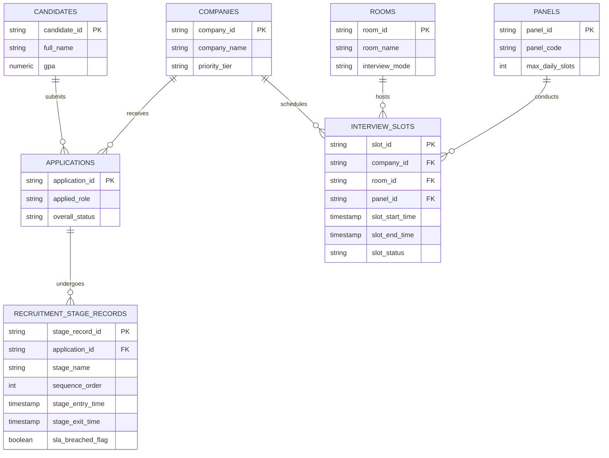

# Final Table Specification Document

# Recruitment Funnel & Capacity Analytics Platform

**Document Version:** 4.0.0 (Final Approved Specification)  
**Author:** Senior Data Architect  
**Target Repository:** `recruitment-analytics/docs/final_table_specification.md`  

---

## 1. Executive Summary & Design Constraints

This document establishes the **FINAL AUTHORITATIVE SPECIFICATION** for the **Recruitment Funnel & Capacity Analytics Platform** database architecture.

### Enforced Architecture Constraints:
1. **Strict Entity Boundary:** The schema contains **EXCLUSIVELY** the 7 approved tables: `candidates`, `companies`, `applications`, `recruitment_stage_records`, `rooms`, `panels`, `interview_slots`.
2. **No Additional Tables:** No lookup master tables, recruiter tables, interviewer tables, drive tables, evaluation logs, or alert tables exist.
3. **Removal of `current_stage_id`:** `current_stage_id` MUST NOT exist on `applications`. Active candidate stage status is derived dynamically from `recruitment_stage_records`.
4. **Decoupled Capacity Engine:** `interview_slots` is strictly a capacity-and-scheduling table containing resource time blocks, room assignments, panel allocations, and booking statuses.
5. **Decoupled Funnel Engine:** `recruitment_stage_records` is the sole source of truth for candidate stage progression, stage turnaround time (TAT), pass/fail scores, and SLA breach flags.

---

## 2. Table Specifications

---

### 2.1 Table 1: `candidates`
* **Purpose:** Stores student/applicant profile records, academic achievements, and demographic metadata.
* **Reason for Existence:** Required to track candidate demographics, degree programs, and compute student cohort yield metrics.

| Column Name | Data Type | Nullable (Y/N) | Default Value | Constraints | Example Value |
| :--- | :--- | :---: | :--- | :--- | :--- |
| `candidate_id` | VARCHAR(50) | N | *None* | PRIMARY KEY | `CND-1001` |
| `full_name` | VARCHAR(255) | N | *None* | NOT NULL | `Ananya Sharma` |
| `email` | VARCHAR(255) | N | *None* | NOT NULL, UNIQUE | `ananya.s@university.edu` |
| `phone_number` | VARCHAR(20) | Y | NULL | *None* | `+91-9876543210` |
| `degree_program` | VARCHAR(100) | N | *None* | NOT NULL | `B.Tech` |
| `academic_major` | VARCHAR(100) | N | *None* | NOT NULL | `Computer Science` |
| `gpa` | NUMERIC(4,2) | N | *None* | NOT NULL, CHECK (gpa >= 0.00 AND gpa <= 10.00) | `8.75` |
| `cgpa_band` | VARCHAR(50) | N | *None* | NOT NULL | `High Distinction` |
| `graduation_year`| INTEGER | N | *None* | NOT NULL, CHECK (graduation_year >= 2000 AND graduation_year <= 2100) | `2026` |
| `gender` | VARCHAR(20) | Y | NULL | *None* | `Female` |
| `created_at` | TIMESTAMPTZ | N | CURRENT_TIMESTAMP | NOT NULL | `2026-01-10 09:30:00+05:30` |

---

### 2.2 Table 2: `companies`
* **Purpose:** Master repository of corporate hiring partner accounts.
* **Reason for Existence:** Required to anchor corporate partner drives, industry sector yield, and company hiring target fulfillment.

| Column Name | Data Type | Nullable (Y/N) | Default Value | Constraints | Example Value |
| :--- | :--- | :---: | :--- | :--- | :--- |
| `company_id` | VARCHAR(50) | N | *None* | PRIMARY KEY | `CMP-101` |
| `company_name` | VARCHAR(255) | N | *None* | NOT NULL | `Acme Cloud Systems` |
| `industry_sector` | VARCHAR(100) | N | *None* | NOT NULL | `Enterprise Software` |
| `priority_tier` | VARCHAR(50) | N | *None* | NOT NULL | `Tier 1 (Dream Partner)` |
| `contact_email` | VARCHAR(255) | N | *None* | NOT NULL | `campus@acmecloud.com` |
| `created_at` | TIMESTAMPTZ | N | CURRENT_TIMESTAMP | NOT NULL | `2025-11-01 10:00:00+05:30` |

---

### 2.3 Table 3: `applications`
* **Purpose:** Represents a candidate's formal job application to a company.
* **Reason for Existence:** Acts as the central relational anchor linking candidates to corporate hiring companies. (`current_stage_id` is removed; active stage is derived from `recruitment_stage_records`).

| Column Name | Data Type | Nullable (Y/N) | Default Value | Constraints | Example Value |
| :--- | :--- | :---: | :--- | :--- | :--- |
| `application_id` | VARCHAR(50) | N | *None* | PRIMARY KEY | `APP-5001` |
| `candidate_id` | VARCHAR(50) | N | *None* | FOREIGN KEY referencing `candidates(candidate_id)` | `CND-1001` |
| `company_id` | VARCHAR(50) | N | *None* | FOREIGN KEY referencing `companies(company_id)` | `CMP-101` |
| `applied_role` | VARCHAR(100) | N | *None* | NOT NULL | `Software Engineer` |
| `overall_status` | VARCHAR(50) | N | 'Active' | NOT NULL, CHECK (overall_status IN ('Active', 'Hired', 'Rejected', 'Withdrawn')) | `Active` |
| `application_date`| DATE | N | *None* | NOT NULL | `2026-02-01` |
| `updated_at` | TIMESTAMPTZ | N | CURRENT_TIMESTAMP | NOT NULL | `2026-02-01 10:00:00+05:30` |

---

### 2.4 Table 4: `recruitment_stage_records` (Funnel Engine)
* **Purpose:** Stores the actual progression event log of an application through every funnel stage.
* **Reason for Existence:** Single source of truth for stage pass/fail conversion rates, candidate score distributions, Stage Turnaround Times (TAT), and SLA breach flags.

| Column Name | Data Type | Nullable (Y/N) | Default Value | Constraints | Example Value |
| :--- | :--- | :---: | :--- | :--- | :--- |
| `stage_record_id` | VARCHAR(50) | N | *None* | PRIMARY KEY | `SR-10001` |
| `application_id` | VARCHAR(50) | N | *None* | FOREIGN KEY referencing `applications(application_id)` | `APP-5001` |
| `stage_name` | VARCHAR(100) | N | *None* | NOT NULL | `Technical Interview 1` |
| `sequence_order` | INTEGER | N | *None* | NOT NULL, CHECK (sequence_order > 0) | `4` |
| `stage_entry_time`| TIMESTAMPTZ | N | *None* | NOT NULL | `2026-02-01 14:00:00+05:30` |
| `stage_exit_time` | TIMESTAMPTZ | Y | NULL | CHECK (stage_exit_time IS NULL OR stage_exit_time >= stage_entry_time) | `2026-02-02 11:00:00+05:30` |
| `stage_status` | VARCHAR(50) | N | 'Pending' | NOT NULL, CHECK (stage_status IN ('Passed', 'Failed', 'Pending', 'Withdrawn')) | `Passed` |
| `evaluation_score`| NUMERIC(5,2)| Y | NULL | CHECK (evaluation_score IS NULL OR (evaluation_score >= 0.00 AND evaluation_score <= 100.00)) | `85.00` |
| `target_sla_hours`| INTEGER | N | *None* | NOT NULL, CHECK (target_sla_hours >= 0) | `48` |
| `sla_breached_flag`| BOOLEAN | N | FALSE | NOT NULL | `FALSE` |
| `created_at` | TIMESTAMPTZ | N | CURRENT_TIMESTAMP | NOT NULL | `2026-02-01 14:00:00+05:30` |

---

### 2.5 Table 5: `rooms`
* **Purpose:** Physical desks and virtual conference link resources available for conducting interviews.
* **Reason for Existence:** Required to track venue resource limits, prevent room double-booking, and compute room capacity occupancy rates.

| Column Name | Data Type | Nullable (Y/N) | Default Value | Constraints | Example Value |
| :--- | :--- | :---: | :--- | :--- | :--- |
| `room_id` | VARCHAR(50) | N | *None* | PRIMARY KEY | `RM-101` |
| `room_name` | VARCHAR(255) | N | *None* | NOT NULL | `Complex Room A` |
| `building_location`| VARCHAR(100)| Y | NULL | *None* | `Student Activity Center` |
| `interview_mode` | VARCHAR(50) | N | *None* | NOT NULL, CHECK (interview_mode IN ('In-Person', 'Virtual', 'Hybrid')) | `In-Person` |
| `seating_capacity` | INTEGER | N | *None* | NOT NULL, CHECK (seating_capacity > 0) | `4` |

---

### 2.6 Table 6: `panels`
* **Purpose:** Evaluator interviewing teams assigned to conduct interviews for specific departments.
* **Reason for Existence:** Required to track interviewing panel availability, daily slot capacity limits, and panel utilization workloads.

| Column Name | Data Type | Nullable (Y/N) | Default Value | Constraints | Example Value |
| :--- | :--- | :---: | :--- | :--- | :--- |
| `panel_id` | VARCHAR(50) | N | *None* | PRIMARY KEY | `PNL-SWE-01` |
| `panel_code` | VARCHAR(100) | N | *None* | NOT NULL, UNIQUE | `SWE-TechPanel-A` |
| `department` | VARCHAR(100) | N | *None* | NOT NULL | `Software Engineering` |
| `max_daily_slots` | INTEGER | N | 8 | NOT NULL, CHECK (max_daily_slots > 0) | `8` |

---

### 2.7 Table 7: `interview_slots` (Capacity & Scheduling Engine)
* **Purpose:** Strictly represents capacity, scheduled time blocks, room allocations, panel assignments, and booking status.
* **Reason for Existence:** Decoupled capacity table required to compute panel slot load, room occupancy, and schedule time availability.

| Column Name | Data Type | Nullable (Y/N) | Default Value | Constraints | Example Value |
| :--- | :--- | :---: | :--- | :--- | :--- |
| `slot_id` | VARCHAR(50) | N | *None* | PRIMARY KEY | `SLT-9001` |
| `company_id` | VARCHAR(50) | N | *None* | FOREIGN KEY referencing `companies(company_id)` | `CMP-101` |
| `room_id` | VARCHAR(50) | N | *None* | FOREIGN KEY referencing `rooms(room_id)` | `RM-101` |
| `panel_id` | VARCHAR(50) | N | *None* | FOREIGN KEY referencing `panels(panel_id)` | `PNL-SWE-01` |
| `hiring_day` | VARCHAR(50) | N | *None* | NOT NULL | `Day 1` |
| `slot_start_time` | TIMESTAMPTZ | N | *None* | NOT NULL | `2026-02-02 10:00:00+05:30` |
| `slot_end_time` | TIMESTAMPTZ | N | *None* | NOT NULL, CHECK (slot_end_time > slot_start_time) | `2026-02-02 10:45:00+05:30` |
| `slot_status` | VARCHAR(50) | N | 'Available' | NOT NULL, CHECK (slot_status IN ('Available', 'Booked', 'Completed', 'Cancelled')) | `Booked` |
| `created_at` | TIMESTAMPTZ | N | CURRENT_TIMESTAMP | NOT NULL | `2026-02-01 16:00:00+05:30` |

---

## 3. Foreign Key Relationship Specification

| Parent Table | Child Table | Foreign Key Column | Cardinality | Business Meaning |
| :--- | :--- | :--- | :---: | :--- |
| `candidates` | `applications` | `applications.candidate_id` | **1 : N** | A student candidate can submit multiple company applications; an application belongs to exactly one candidate. |
| `companies` | `applications` | `applications.company_id` | **1 : N** | A company receives multiple candidate applications; an application is tied to one company. |
| `applications` | `recruitment_stage_records` | `recruitment_stage_records.application_id` | **1 : N** | An application progresses through multiple sequential stage event records over time. |
| `companies` | `interview_slots` | `interview_slots.company_id` | **1 : N** | A company schedules multiple interview capacity slots for its recruitment drive. |
| `rooms` | `interview_slots` | `interview_slots.room_id` | **1 : N** | A room resource hosts multiple sequential time slots; a slot occupies one room resource. |
| `panels` | `interview_slots` | `interview_slots.panel_id` | **1 : N** | A panel conducts multiple interview slots; a slot is assigned to one evaluator panel. |

---

## SECTION A: Final Entity Relationship Summary



---

## SECTION B: Validation Constraints

1. **Active Stage Derivation Rule:** Current active stage for an application MUST be derived dynamically via SQL:
   ```sql
   SELECT stage_name FROM recruitment_stage_records 
   WHERE application_id = 'APP-5001' 
   ORDER BY sequence_order DESC LIMIT 1;
   ```
2. **Sequential Progression Constraint:** An application CANNOT have a record for `sequence_order = k` unless a prior record for `sequence_order = k - 1` exists with `stage_status = 'Passed'`.
3. **Chronological Validity:**
   - In `recruitment_stage_records`: `stage_exit_time >= stage_entry_time`.
   - In `interview_slots`: `slot_end_time > slot_start_time`.
4. **Room Overlap Prohibition:** For any two slots $A$ and $B$ sharing `room_id`, the condition $(\text{start}_A < \text{end}_B \text{ AND } \text{start}_B < \text{end}_A)$ MUST evaluate to `FALSE`.
5. **Panel Overlap Prohibition:** For any two slots $A$ and $B$ sharing `panel_id`, the condition $(\text{start}_A < \text{end}_B \text{ AND } \text{start}_B < \text{end}_A)$ MUST evaluate to `FALSE`.
6. **Panel Daily Slot Limit:** Total booked slots per panel per calendar day MUST NOT exceed `panels.max_daily_slots`.
7. **Automated SLA Breach Rule:** If $(\text{stage\_exit\_time} - \text{stage\_entry\_time}) > \text{target\_sla\_hours}$, `sla_breached_flag` MUST be `TRUE`.

---

## SECTION C: Synthetic Data Generation Considerations

To populate this decoupled architecture using [data_generator.py](file:///c:/Users/Lenovo/Desktop/Project%20Product/recruitment-analytics/python/generators/data_generator.py), the generation script must follow this exact order:

1. **Entity Generation Order:**
   - Step 1: `candidates` (1,000 – 1,500 records)
   - Step 2: `companies` (150 – 300 records)
   - Step 3: `rooms` (20 – 30 physical/virtual room records)
   - Step 4: `panels` (30 – 50 department panel records)
   - Step 5: `applications` (4,000 – 8,000 candidate-company application records)
   - Step 6: `recruitment_stage_records` (20,000 – 60,000 stage transition event records)
   - Step 7: `interview_slots` (15,000 – 30,000 capacity time blocks)

2. **Stage Progression Funnel Ratios:**
   - Sourcing (Seq 1) $\rightarrow$ Screening (Seq 2): $100\%$ pass-through.
   - Screening (Seq 2) $\rightarrow$ Assessment (Seq 3): $65\%$ pass-through.
   - Assessment (Seq 3) $\rightarrow$ Tech Interview 1 (Seq 4): $35\%$ pass-through.
   - Tech Interview 1 (Seq 4) $\rightarrow$ Tech Interview 2 (Seq 5): $45\%$ pass-through.
   - Tech Interview 2 (Seq 5) $\rightarrow$ HR Interview (Seq 6): $60\%$ pass-through.
   - HR Interview (Seq 6) $\rightarrow$ Offer Extended (Seq 7): $85\%$ pass-through.
   - Offer Extended (Seq 7) $\rightarrow$ Joined (Seq 8): $75\%$ acceptance rate.

3. **SLA Breach Distribution:**
   - Inject log-normal turnaround times centered around stage target SLA hours.
   - Introduce an artificial $12\%$ SLA breach frequency in `recruitment_stage_records` to validate SLA alerting views.
