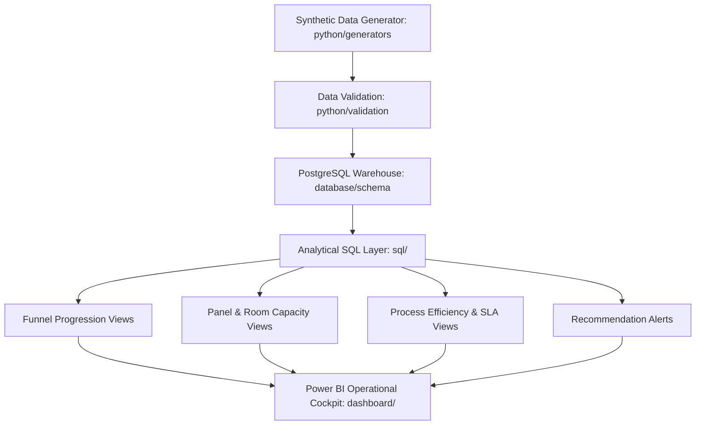

# Project Overview: Recruitment Funnel & Capacity Analytics Platform

## 1. Business Context & Problem Statement

Campus recruitment is a high-volume, time-sensitive operational process. Organizations compete for top graduate talent within short hiring windows.

The **Recruitment Funnel & Capacity Analytics Platform** provides an analytics and decision-support layer built on top of recruitment data warehouses.

---

## 2. Final Approved Entities (7) & Scale Targets

The platform relies **EXCLUSIVELY** on the 7 approved entities:

1. **`candidates`** (Target: 1,000 – 1,500)
2. **`companies`** (Target: 150 – 300)
3. **`applications`** (Target: 4,000 – 8,000)
4. **`recruitment_stages`** (8 standard stages)
5. **`interview_slots`** (Target: 20,000 – 60,000 stage/slot records)
6. **`rooms`** (Physical and virtual room resources)
7. **`panels`** (Department evaluator panels)

> [!NOTE]
> Removed entities: `placement_drives`, `recruiters`, `interviewers`, `stage_evaluations`.

---

## 3. Platform Architecture & Data Pipeline Flow

---

## 4. Analytical Modules

- **Funnel Analytics:** Stage-by-stage candidate progression and pass rates.
- **Capacity Analytics:** Panel daily slot load and room capacity utilization.
- **Process Efficiency:** Stage Turnaround Time (TAT) and SLA breach tracking.
- **Recommendation Engine:** Automated capacity rebalancing and SLA breach alerts.
